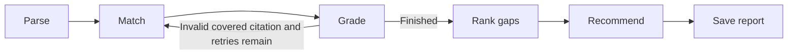

# SkillGap

A private, local-first Python agent that compares a resume with one or more job
descriptions, cites supporting evidence, and suggests small projects or focused
learning tasks. Built with LangGraph, Ollama, sentence-transformers, SQLite, and
FastAPI with a custom HTML/CSS/JavaScript interface. Designed as an understandable final-year CSE project.

## Run locally

Use Python 3.11 or newer. Install [Ollama for Windows](https://ollama.com/download/windows)
from its official installer and open the Ollama app. On Linux, start `ollama serve`
if the service is not already running. See the [official quickstart](https://docs.ollama.com/quickstart).

From the repository root in PowerShell:

```powershell
ollama pull qwen2.5:1.5b
python -m venv .venv
.\.venv\Scripts\python.exe -m pip install --upgrade pip
.\.venv\Scripts\python.exe -m pip install -e ".[dev]" -c constraints-tested.txt
.\.venv\Scripts\python.exe -m skillgap.prepare_models
.\.venv\Scripts\python.exe -m unittest discover -s skillgap/tests -v
.\.venv\Scripts\python.exe -m skillgap.app
```

Open `http://127.0.0.1:8501`. Upload a PDF or UTF-8 text resume, paste job
descriptions separated by a line containing `---`, and select **Analyze**.
Alternatively, click **Try a sample analysis** to try the included roles.
The report shows covered, partial, and missing requirements, exact citations,
retrieved candidates, ranked gaps, and recommendations. Download it as JSON.

`constraints-tested.txt` pins the core versions used for the verified Windows
build. If another OS/Python version has no wheel for a pinned version, install
without `-c constraints-tested.txt`; the dependency ranges remain in `pyproject.toml`.
Initial model downloads need a network connection; downloaded weights and all
inference stay local. `prepare_models` is optional: it downloads only the pinned
MiniLM snapshot with no resume content. The normal embedding loader can also
download it automatically.

## Models and configuration

All policy settings live in `skillgap/config.py`. Defaults use local
`qwen2.5:1.5b`, CPU Ollama inference, and pinned `all-MiniLM-L6-v2` embeddings.
The default prompt batch size is 64 to keep Ollama's compute buffers small.
The 1.5B model balances this development machine's memory limits with structured
output quality. A larger local instruction model may improve extraction if your
machine has enough memory; keep the local-model setting explicit.

```powershell
$env:SKILLGAP_OLLAMA_MODEL = "qwen2.5:1.5b"
$env:SKILLGAP_OLLAMA_NUM_GPU = "0"
$env:SKILLGAP_OFFLINE = "1"  # after downloading embeddings
# Optional: use an existing folder outside OneDrive/Dropbox/etc.
$env:SKILLGAP_DB_PATH = "C:\LocalData\SkillGap\skillgap.sqlite3"
```

Setting `SKILLGAP_OLLAMA_NUM_GPU=-1` lets Ollama choose GPU offloading. CPU is the
default because GPU allocation failed in this machine's initial check. Larger
models and context windows also consume system memory. Ollama errors produce
visible incomplete results; the app never switches to an API automatically.

API mode supports an OpenAI-compatible **Chat Completions** endpoint. Selecting
**API · external** in Model settings explicitly switches providers and displays a transmission
notice. You can also configure it before startup:

```powershell
$env:SKILLGAP_LLM_PROVIDER = "api"
$env:SKILLGAP_API_BASE_URL = "https://your-provider.example/v1"
$env:SKILLGAP_API_MODEL = "your-model-name"
$env:SKILLGAP_API_KEY = "your-key"
```

In API mode, resume evidence and job descriptions are sent to that provider.
Provider support for JSON-object responses is required. Keys are excluded from
configuration reprs and saved reports. API compatibility is covered by mock
transport tests; no external model was used for the local evaluation.

## How the workflow works



| Node | Why it exists |
| --- | --- |
| Parse | Extract PDF/text locally; validate JSON resume entries and job requirements with exact source quotes; reuse SQLite caches. |
| Match | Retrieve the most similar verbatim resume lines using local embeddings, without making a grade decision. |
| Grade | Apply deterministic thresholds and ask the LLM whether a high-scoring line supports the complete requirement. |
| Retry edge | Broaden the candidate count only for invalid covered citations; increment counters per requirement and stop after two retries by default. |
| Rank | Count distinct jobs mentioning a partial/missing requirement, then prefer required gaps on frequency ties. |
| Recommend | Return one validated project or study task per top gap, with a deliverable, 2-24 hour estimate, resource type, and hypothetical resume wording. |
| Report | Assemble evidence, grades, warnings, and recommendations and store JSON plus links to the analyzed jobs. |

The typed state carries resume bytes/text, structured entries, job descriptions,
requirements, candidates, grades, retry counters, rankings, and reports. Service
objects are injected into nodes rather than serialized into state. This makes
the workflow testable with mocked LLMs and controlled embedding vectors.

Embeddings run in a short-lived local worker, with all cache misses batched per
match node. This releases PyTorch memory before grading. Text travels over local
process pipes; there is no separate server or external embedding API. Ollama
also unloads after each call by default to fit modest memory budgets. Set
`SKILLGAP_OLLAMA_KEEP_ALIVE=5m` to trade more memory for faster repeated calls.
A local file lock permits one analysis at a time per database. A second CLI/UI
run gets a clear busy message instead of overlapping the model memory peaks.

### Grading policy

- **Covered:** top similarity is at least `high_similarity`, the LLM confirms
  the complete requirement, and its citation exactly matches the top retrieved
  line and an extracted resume line.
- **Partial:** score is at least `low_similarity` but below the high threshold,
  or high similarity has no validated LLM confirmation.
- **Missing:** there are no candidates, or the best score is below the low threshold.

An invalid covered citation becomes partial immediately, then triggers broader
retrieval if retries remain. Grading cannot turn a fabricated citation into a
covered claim. A negative support decision also remains partial under this
conservative policy. Missing means missing **resume evidence**, not proof that
the person lacks a skill. Scores are cosine similarities, not probabilities.
An ongoing-study line cannot confirm a completed degree unless it also contains
explicit completion evidence; this guard addresses a false covered claim found
in the local evaluation.

The starting 0.70/0.40 thresholds were revised to **0.49/0.30** after inspecting
the included MiniLM pairs: clear Flask and pandas evidence scored about 0.54
and 0.52, while a line explicitly describing SQL queries scored 0.34. A clear
Flask familiarity requirement scored 0.495 after extraction. These are
small-sample defaults and need calibration for different resumes and models.
Lowering the high threshold increases LLM checks; it does not bypass support
confirmation or citations. See `skillgap/evaluation/` for outputs and limitations.

### Structured output failures

Every model call requests JSON only, supplies a schema, validates types with
Pydantic, and retries once with stricter instructions. Extraction also checks
source quotes against the actual input. After repeated failure, the safe default
is used and the report shows a warning. An unparsed job contributes no graded
requirements, so failed extraction cannot masquerade as a successful analysis.
Failed parses are not cached. Recommendation failures produce labeled generic
study tasks rather than stopping the workflow. Logs contain error classes, not
resume text or response bodies.

## Storage and privacy

| SQLite table | Stored information |
| --- | --- |
| `resumes` | Input hash, parser/model fingerprint, filename, extracted text, structured entries |
| `job_descriptions` | Job text, hash, parser/model fingerprint, extraction JSON |
| `requirements` | Per-job requirement text, required/preferred tag, canonical grouping key, source quote |
| `embeddings` | Text hash, model/revision fingerprint, dimensions, vectors |
| `reports` | Report JSON, resume link, non-secret settings, result fingerprint |
| `report_jobs` | Links between reports and job descriptions |

Hashes avoid repeating extraction and embeddings for identical inputs. Parser,
prompt, provider, model, and embedding revision settings participate in relevant
cache keys. Exact-text duplicate requirements are collapsed, retaining required
priority. Foreign keys and transactions prevent dangling links or half-saved job
extractions. WAL allows reads while another connection writes. Schema version 1
is tracked with SQLite `user_version`.

Reports are saved as results rather than used to skip fresh grading: this avoids
silently returning a stale semantic decision after changing prompts or policy.
If resume parsing fails, the incomplete report is shown/exportable in the UI but
is not saved as a successful cached resume/report record.

Local mode restricts Ollama to loopback, disables environment proxies and HTTP
redirects for LLM calls, blocks cloud model names, and checks `/api/show` for
cloud-backed aliases before sending document text. Embedding inference runs on
CPU with `trust_remote_code=False`. FastAPI binds to loopback; the frontend
uses local assets, blocks external resources with a content security policy,
and rejects cross-origin analysis submissions. The public analysis helper explicitly disables LangSmith
tracing, overriding inherited tracing environment settings; no cloud checkpointer
is configured. This uses the [documented tracing context](https://docs.langchain.com/langsmith/trace-without-env-vars).

SQLite stores personal text in plain form; it is not encrypted. `data/`, database
sidecars, virtual environments, and credentials are ignored by Git. Keep the
database outside synced folders for strict local storage. This checkout is under
OneDrive, so its default `data/` folder can be synced by OneDrive. Model downloads
disclose the model identifier to the model host, not resume contents.

## Source files in reading order

1. `skillgap/app.py` - local FastAPI adapter and server launcher; `web/` contains the custom interface.
2. `skillgap/config.py` - validated settings and tunable policy.
3. `skillgap/db.py` - schema, transactions, and cache helpers.
4. `skillgap/parsers.py` - PDF/text extraction, evidence lines, job separators.
5. `skillgap/llm.py` - local/API transport, schemas, JSON retry/fallback.
6. `skillgap/embeddings.py` - local encoder, SQLite cache, cosine retrieval.
7. `skillgap/graph/state.py` - typed input and artifact state.
8. `skillgap/graph/nodes.py` - nodes and pure grading/ranking functions.
9. `skillgap/graph/workflow.py` - LangGraph wiring and public `analyze` helper.
10. `skillgap/prompts/` - JSON-only extraction, support, and recommendation templates.
11. `skillgap/tests/` - parsing, cache, threshold, ranking, retry, workflow, and UI tests.

`skillgap/examples/` contains only synthetic data. The sample PDF can be rebuilt
with `python -m skillgap.examples.create_sample_pdf`. PDFs must contain readable
text; scanned/image-only pages need local OCR or a text version. Upload/context
limits fail explicitly rather than silently truncating a resume.

## Evaluation and demo

```powershell
.\.venv\Scripts\python.exe -m skillgap.evaluation.run_evaluation
```

The runner uses the same synthetic student resume against condensed, paraphrased
requirements from an [Enveritas backend posting](https://job-boards.greenhouse.io/enveritas/jobs/4006514008)
and a [SteerBridge analyst posting](https://jobs.lever.co/steerbridge/31c8e973-ad10-4b76-8289-410cd1731089).
These roles contain seniority and eligibility requirements, useful for checking
that student projects do not imply professional tenure or completed credentials.
This is evaluation of selected requirements, not an assessment of either full
posting or a recommendation to apply. The fixtures retain links and review dates.

The evaluation folder contains the similarity pairs, per-role JSON reports, and
a manual review note. The demo folder contains screenshots of the local UI.
No video is created. No private user resume is included.

## Limits and next improvements

- Exact citations prove a line exists; they do not prove the LLM's interpretation
  is correct. Negation, proficiency, experience years, and compound requirements
  need manual review.
- Resume line extraction can be imperfect for multi-column PDFs. There is no OCR.
- Canonical grouping guards model-generated keys against the requirement text
  and distinguishes explicit tool combinations and tenure. Equivalent phrasing
  can still split across groups; this is not a complete skill ontology.
- Broader retrieval returns more candidates but may leave the same top line;
  retries improve citation recovery, not every kind of semantic mismatch.
- Study tasks and projects cannot satisfy years of employment, citizenship,
  clearance, or degree requirements. Suggested resume wording is conditional on
  completing the work; recommendations cannot certify competence.
- This is a local prototype without authentication. Its FastAPI adapter calls
  the LangGraph workflow directly; run it only on the default loopback address.

## Interface design

The custom interface replaces Streamlit with a responsive workspace, a sage and
cream palette, drag-and-drop uploads, role filtering, three evidence columns,
ranked gaps, expandable source/candidate citations, and actionable recommendations.
FastAPI serves ordinary HTML/CSS/JavaScript without Node, remote fonts, analytics,
or browser storage. Inference runs in a worker thread so the server stays
responsive. Inputs are locked during analysis and editing them clears stale
results. API processing requires explicit consent before a document is sent.

The upload adapter follows FastAPI's [form/file handling](https://fastapi.tiangolo.com/tutorial/request-forms-and-files/)
and [local static file serving](https://fastapi.tiangolo.com/tutorial/static-files/).

Use **Open saved report** to inspect an exported SkillGap JSON report without a model call. This reads the file locally and clears the input fields to distinguish the saved analysis from a new run.

